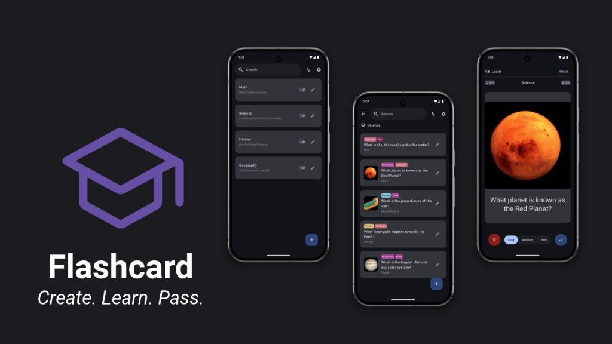

# Flashcard - Android

> **Looking for the official project page?**  
> Visit the official website: [balazs-volcsei.github.io/flashcard-android](https://balazs-volcsei.github.io/flashcard-android/)

---

**Flashcard** is a fast, clean, and 100% offline study application designed for Android. Built with modern Android tools, it provides a seamless experience for creating custom decks, organizing cards with tags, and mastering study material with reactive state management and smart progress tracking.

      

## Key Features

- **Full Content Management:** Create, read, update, and delete decks, flashcards, and organizational tags through a consistent bottom-sheet interface.
- **Offline First:** Fully functional without an internet connection, ensuring study decks and progress are always available.
- **Modern UI/UX:** Fully designed with **Material 3** and **Jetpack Compose**, featuring smooth animations and intuitive swipe-to-action gestures.
- **Context-Aware & Batch Operations:** Dynamic search, sorting, and multi-select batch editing for managing large study decks effortlessly.
- **Rich Media Cards:** Attach images to flashcards for visual learning, powered by fast local caching.
- **Progress Tracking:** At-a-glance statistics showing completion percentages and remaining cards per deck.

## Tech Stack

- **UI:** Jetpack Compose with Material 3.
- **Architecture:** Clean Architecture with MVI & MVVM + Repository Pattern.
- **Asynchronicity:** Kotlin Coroutines & Flow.
- **Dependency Injection:** Dagger Hilt.
- **Local Storage:** Room Database for persistence & DataStore for user preferences.
- **Navigation:** Compose Navigation (single-activity structure).
- **Image Loading:** Coil.

## Screenshots

 

## Roadmap

- [x] Core MVI Architecture and Room Setup
- [x] Implementing Search and Sort Functions
- [x] Multi-select and Batch Editing
- [x] Image Attachment Support
- [x] Extending Functionality with Tags
- [x] Implementing Learning Business Logic (In Progress)
- [ ] AdMob Integration
- [ ] Play Store Beta Release

## Recent Updates

### 3 March 2026
- Implemented basic learning logic with statistics.
- Improved UX/UI experience.
- Added swipe actions to deck and flashcard list items.
- Enhanced animations across the application.
- Bug fixes and performance improvements.

### 23 February 2026
- Added tags for flashcards to improve organization.
- Enhanced UX/UI experience across the creation flow.

### 7 February 2026
- Implemented core MVI architecture and Room database persistence.
- Added reactive search and sort functionality.
- Added batch-edit mode for deck and card management.

## Developer

**Völcsei Balázs E.V.**  
*Android Developer*

- **Portfolio:** [balazs-volcsei.github.io](https://balazs-volcsei.github.io/)
- **LinkedIn:** [balazs-volcsei](https://www.linkedin.com/in/balazs-volcsei/)
- **Email:** balazs.volcsei@gmail.com

---
*Flashcard - Create. Learn. Pass.*
